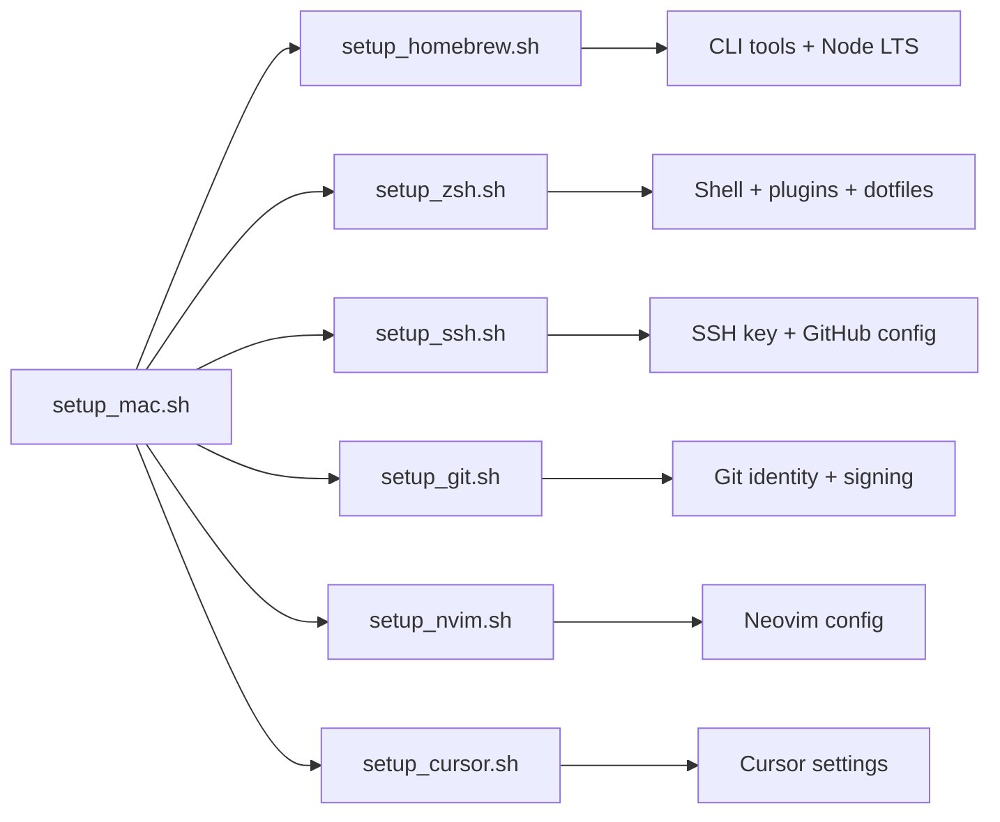

# macOS Development Setup

Idempotent scripts and dotfiles to bootstrap a macOS machine for daily development. Covers the full stack: **Homebrew**, **zsh** (Oh My Zsh + zplug + powerlevel10k), **Neovim** (Lazy.nvim), **Git** with SSH commit signing, and **Cursor** settings.

Designed to be safe to re-run — existing files are backed up with a timestamp before being overwritten.

## Prerequisites

- macOS (Apple Silicon or Intel)
- Internet access
- A terminal with `zsh` (macOS default)
- Optional: [Cursor](https://cursor.com) installed for IDE settings sync

## Quick Start

### Fresh machine

```bash
git clone <repo-url> ~/dev/setup
cd ~/dev/setup
chmod +x setup_mac.sh verify_setup.sh setup_*.sh lib/common.sh

./setup_mac.sh
./verify_setup.sh
```

### Existing machine

If you already have dotfiles, migrate secrets and machine-specific PATH entries first:

```bash
cd ~/dev/setup
chmod +x setup_*.sh verify_setup.sh lib/common.sh

# 1. Preserve secrets and per-machine config (never committed to git)
cp .zshrc.local.example ~/.zshrc.local
# Move API keys, pnpm, asdf, java, etc. from ~/.zshrc into ~/.zshrc.local

# 2. Apply only what you need
./setup_mac.sh zsh
./setup_mac.sh git
./setup_mac.sh cursor

# 3. Validate
./verify_setup.sh
```

After zsh setup, restart your terminal or run `source ~/.zshrc`.

## What Gets Installed



| Step | Script | Installs / configures |
|------|--------|---------------------|
| 1 | `setup_homebrew.sh` | Homebrew, core CLI tools, nvm + Node LTS |
| 2 | `setup_zsh.sh` | Oh My Zsh, zplug, nerd font, shell dotfiles |
| 3 | `setup_ssh.sh` | `~/.ssh/id_ed25519`, GitHub SSH config, allowed signers |
| 4 | `setup_git.sh` | Global git config, aliases, SSH commit signing |
| 5 | `setup_nvim.sh` | Neovim dependencies + `~/.config/nvim` |
| 6 | `setup_cursor.sh` | Cursor `settings.json` and `keybindings.json` |

Run individual steps:

```bash
./setup_mac.sh homebrew
./setup_mac.sh zsh
./setup_mac.sh ssh
./setup_mac.sh git
./setup_mac.sh nvim
./setup_mac.sh cursor
```

## Homebrew

`setup_homebrew.sh` installs:

**Formulae:** `git`, `gh`, `neovim`, `ripgrep`, `fd`, `fzf`, `nvm`, `yarn`, `node`

**Casks:** `font-roboto-mono-nerd-font`

It also writes Homebrew `shellenv` to `~/.zprofile` (supports both `/opt/homebrew` and `/usr/local`) and installs Node LTS via nvm.

## Shell (zsh)

### Stack

| Layer | Tool | Purpose |
|-------|------|---------|
| Framework | [Oh My Zsh](https://ohmyzsh.sh/) | Base shell framework |
| Plugin manager | [zplug](https://github.com/zplug/zplug) | Plugin and theme loading |
| Theme | [powerlevel10k](https://github.com/romkatv/powerlevel10k) | Prompt (configured in `.p10k.zsh`) |
| Plugins | enhancd, fzf, zsh-syntax-highlighting | Directory jump, fuzzy find, highlighting |

### Dotfiles

| Repo file | Installed to | Notes |
|-----------|--------------|-------|
| `.zprofile` | `~/.zprofile` | Homebrew PATH |
| `.zshrc` | `~/.zshrc` | Main shell config |
| `.p10k.zsh` | `~/.p10k.zsh` | Prompt theme |
| `.bash_aliases` | `~/.bash_aliases` | Shared aliases |
| `.zshrc.local.example` | `~/.zshrc.local` | Created once; never overwritten |

### Machine-specific config

Put secrets and per-machine overrides in `~/.zshrc.local` — API keys, pnpm, asdf, Java, extra PATH entries, etc. This file is gitignored and never touched by setup scripts.

```bash
cp .zshrc.local.example ~/.zshrc.local
$EDITOR ~/.zshrc.local
```

### Terminal font

After setup, set your terminal font to **RobotoMono Nerd Font** (iTerm2 → Profiles → Text → Font).

## Neovim

Modular [Lazy.nvim](https://github.com/folke/lazy.nvim) config based on Kickstart.nvim.

### Structure

```
nvim/
├── init.lua
└── lua/
    ├── config/          # options, keymaps, autocmds
    └── plugins/         # one file per plugin group
        ├── lsp.lua
        ├── completion.lua
        ├── telescope.lua
        ├── treesitter.lua
        ├── git.lua
        ├── avante.lua
        └── ...
```

### After setup

```vim
:Lazy sync      " install / update plugins
:checkhealth    " verify everything works
:Mason          " install language servers
```

### Key bindings

Leader key is `<Space>`.

| Key | Action |
|-----|--------|
| `<leader>sf` | Search files |
| `<leader>sg` | Live grep |
| `<leader>?` | Recent files |
| `<leader><space>` | Switch buffers |
| `gd` | Go to definition |
| `gr` | Go to references |
| `K` | Hover documentation |
| `<leader>rn` | Rename symbol |
| `<leader>ca` | Code actions |
| `<leader>e` | Show diagnostics |
| `[d` / `]d` | Previous / next diagnostic |

### Link vs copy

By default, `setup_nvim.sh` copies the config to `~/.config/nvim`. To symlink the repo instead (live edits):

```bash
LINK_MODE=link ./setup_nvim.sh
```

### AI plugins

Avante.nvim reads API keys from environment variables — never hardcode them in Lua files. Set keys in `~/.zshrc.local`:

```bash
export OPENROUTER_API_KEY="your-key-here"
export GROQ_API_KEY="your-key-here"
```

MCP server credentials go in `mcphub/servers.json` (local only, gitignored). Copy from the example:

```bash
cp mcphub/servers.json.example mcphub/servers.json
# edit mcphub/servers.json with your keys
```

## Git & SSH

### SSH key and GitHub

```bash
./setup_ssh.sh

# Upload key to GitHub
gh ssh-key add ~/.ssh/id_ed25519.pub -t "$(hostname)-$(date +%Y-%m-%d)"

# Verify
ssh -T git@github.com
```

`setup_ssh.sh` generates an ed25519 key if one doesn't exist, installs `ssh/config` for GitHub, adds the key to the macOS keychain, and creates `~/.ssh/allowed_signers` for commit signing.

### Git config

`setup_git.sh` configures:

- `user.name` / `user.email` (override with `GIT_NAME` / `GIT_EMAIL` env vars)
- `core.editor` → `nvim`
- SSH commit signing (`gpg.format=ssh`, `commit.gpgsign=true`)

### Aliases

Defined in `.bash_aliases`:

| Alias | Command |
|-------|---------|
| `gitfep` | `git fetch && git pull origin $(git branch --show-current)` |
| `gpcb` | `git push origin $(git branch --show-current)` |
| `git-prune-branches` | Prune remote-tracking branches and delete stale local branches |

## Cursor

`setup_cursor.sh` syncs editor settings from `cursor/` to:

```
~/Library/Application Support/Cursor/User/
├── settings.json
└── keybindings.json
```

Restart Cursor after running the script.

## Verify

```bash
./verify_setup.sh
```

Checks 19 items: Homebrew, CLI tools, shell plugins, dotfiles, Neovim, SSH, Git config, Cursor settings, and GitHub SSH authentication. Exits with code 1 if anything fails.

## Repository Layout

```
├── setup_mac.sh              # Main orchestrator
├── setup_homebrew.sh
├── setup_zsh.sh
├── setup_nvim.sh
├── setup_ssh.sh
├── setup_git.sh
├── setup_cursor.sh
├── verify_setup.sh
├── lib/common.sh             # Shared helpers (logging, backups, brew detection)
├── .zshrc / .p10k.zsh        # Shell dotfiles
├── .zprofile                 # Homebrew shellenv
├── .zshrc.local.example      # Machine-specific overrides template
├── .bash_aliases
├── git-prune-local.sh        # Branch cleanup helper
├── ssh/config                # GitHub SSH config
├── cursor/                   # Cursor IDE settings
└── nvim/                     # Neovim (Lazy.nvim) config
```

## Customization

### Add a zsh plugin

Edit `.zshrc` and add a `zplug` line, then re-run `./setup_zsh.sh`:

```zsh
zplug "zsh-users/zsh-autosuggestions"
```

### Add a Neovim plugin

Create `nvim/lua/plugins/my-plugin.lua`:

```lua
return {
  'author/plugin-name',
  config = function()
    -- plugin config
  end,
}
```

Restart Neovim — Lazy.nvim auto-detects new files.

### Update dotfiles on a running machine

Edit files in the repo, then re-run the relevant setup script. Backups are created automatically (e.g. `~/.zshrc.bak.20250621143000`).

## Troubleshooting

| Problem | Fix |
|---------|-----|
| `brew: command not found` after install | Open a new terminal or run `source ~/.zprofile` |
| Prompt looks broken / missing icons | Set terminal font to RobotoMono Nerd Font |
| `zplug: command not found` | Run `./setup_zsh.sh` |
| Plugins not loading in Neovim | `:Lazy sync` then `:checkhealth` |
| LSP not working | `:Mason` to install servers, then `:LspInfo` |
| GitHub SSH fails | Run `./setup_ssh.sh`, then `gh ssh-key add ~/.ssh/id_ed25519.pub` |
| Signed commits fail | Ensure `~/.ssh/allowed_signers` exists — run `./setup_ssh.sh` then `./setup_git.sh` |
| API keys missing in Neovim | Add exports to `~/.zshrc.local`, restart terminal |

### Reset Neovim plugin state

```bash
rm -rf ~/.local/share/nvim ~/.local/state/nvim
nvim   # Lazy.nvim reinstalls everything
```

## Security

This repo is designed so **API keys and tokens never get committed**.

### Where secrets belong

| Secret type | Location | Committed? |
|-------------|----------|------------|
| API keys (OpenRouter, Groq, etc.) | `~/.zshrc.local` | No — gitignored |
| MCP server credentials | `mcphub/servers.json` | No — gitignored |
| SSH private keys | `~/.ssh/` | No — never in repo |
| Env files | `.env`, `.env.local` | No — gitignored |

### Checks before committing

```bash
# Scan the repo for leaked secrets
./scripts/check-secrets.sh

# Install a pre-commit hook (also runs automatically via ./setup_mac.sh)
./scripts/install-git-hooks.sh
```

The pre-commit hook blocks commits that match known key patterns (OpenAI `sk-proj-`, Groq `gsk_`, OpenRouter `sk-or-v1-`, GitHub tokens, AWS keys, private keys, etc.).

### Rules

1. Never put real API keys in `.zshrc`, Lua configs, JSON settings, or scripts
2. Use `~/.zshrc.local` for all secrets — setup scripts never overwrite it
3. Use `mcphub/servers.json.example` as a template; keep real values in `mcphub/servers.json` (gitignored)
4. Run `./scripts/check-secrets.sh` before pushing if you edit config files

## Legacy Scripts

| Old script | Replaced by |
|------------|-------------|
| `setup_vim.sh` | `setup_nvim.sh` |
| `git_setup.sh` | `setup_git.sh` |

Both legacy scripts redirect to their replacements.
