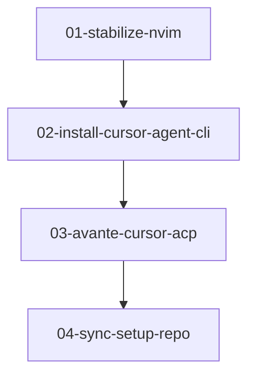

# Neovim AI Migration — Agent Briefs

Self-contained implementation briefs for migrating Neovim to Cursor Agent via ACP, while keeping Avante + MCPHub.

**This folder is documentation for agents.** Implementing a brief means editing live Neovim config / setup scripts — not rewriting these docs unless the brief says so.

## Architecture defaults (locked)

| Decision | Choice |
|----------|--------|
| ACP path | Extend **Avante** with `acp_providers.cursor` (Cursor’s documented Neovim path) |
| Default Avante provider | **OpenRouter** (quick interactive edits) |
| Cursor account / quota | Official **Cursor Agent CLI** (`agent acp`) + `agent login` — no unofficial API proxies |
| MCP for Avante | Keep **MCPHub.nvim** as-is |
| Edit order | Change `~/.config/nvim` first, then mirror to `~/dev/setup/nvim` (or use `LINK_MODE=link`) |

## Deferred (see [LATER.md](./LATER.md))

- Claude Code via ACP or terminal fallback
- Shared MCP config across Cursor / Claude / MCPHub
- CodeCompanion.nvim or agentic.nvim as a second AI UI

## Briefs (run in order)

| Order | Brief | What the agent implements |
|------:|-------|---------------------------|
| 1 | [01-stabilize-nvim.md](./01-stabilize-nvim.md) | Fix Neovim init errors (oxlint, Copilot noise, Avante input, LSP cleanup, treesitter keys) |
| 2 | [02-install-cursor-agent-cli.md](./02-install-cursor-agent-cli.md) | Install Cursor Agent CLI, PATH, login docs, setup/verify scripts |
| 3 | [03-avante-cursor-acp.md](./03-avante-cursor-acp.md) | Avante `acp_providers.cursor` + `<leader>a*` AI keymaps |
| 4 | [04-sync-setup-repo.md](./04-sync-setup-repo.md) | Mirror nvim config into setup repo + README + verify |



### Dependencies

- **01** has no prerequisites.
- **02** can run after or in parallel with 01, but **03** needs both 01 and 02 (clean Avante + working `agent`).
- **02** requires a **human** for interactive `agent login`.
- **04** should run last (or incrementally after each brief if you prefer continuous sync).

## How to spawn an agent

Paste one of these prompts into a new Cursor agent (only one brief per agent):

### Brief 01

```text
Implement only the brief in ~/dev/setup/docs/nvim-ai/01-stabilize-nvim.md.
Follow its acceptance criteria. Do not start 02+ until 01 passes.
Do not edit docs/nvim-ai briefs unless the brief explicitly asks.
```

### Brief 02

```text
Implement only the brief in ~/dev/setup/docs/nvim-ai/02-install-cursor-agent-cli.md.
Follow its acceptance criteria. Pause for human `agent login` when required.
Do not implement Avante ACP (that is 03) or sync (04) in this agent.
```

### Brief 03

```text
Implement only the brief in ~/dev/setup/docs/nvim-ai/03-avante-cursor-acp.md.
Prerequisites: 01 and 02 must already pass (`agent` on PATH and authenticated).
Follow its acceptance criteria. Do not run 04 sync unless asked.
```

### Brief 04

```text
Implement only the brief in ~/dev/setup/docs/nvim-ai/04-sync-setup-repo.md.
Mirror the live ~/.config/nvim changes from 01–03 into ~/dev/setup and update docs/verify.
Do not commit secrets. Do not invent new AI features beyond syncing what exists.
```

## Key paths

| Path | Role |
|------|------|
| `~/.config/nvim` | Live Neovim config (edit first) |
| `~/dev/setup/nvim` | Canonical copy in setup repo |
| `~/dev/setup/setup_nvim.sh` | Installs/copies nvim config |
| `~/dev/setup/setup_cursor.sh` | Cursor IDE settings (CLI may extend this or a sibling script) |
| `~/dev/setup/verify_setup.sh` | Environment checks |
| `~/.config/mcphub/servers.json` | MCP credentials — **never commit** |

## Source discovery notes (as of 2026-08-01)

- Neovim **v0.12.3**; Lazy.nvim; Avante + MCPHub + which-key already installed.
- Cursor IDE binary exists (`cursor`); **`agent` CLI is missing**.
- Claude Code is **not** installed.
- Known init issues documented in brief 01 (oxlint cmd, Copilot auth file, native input provider).
